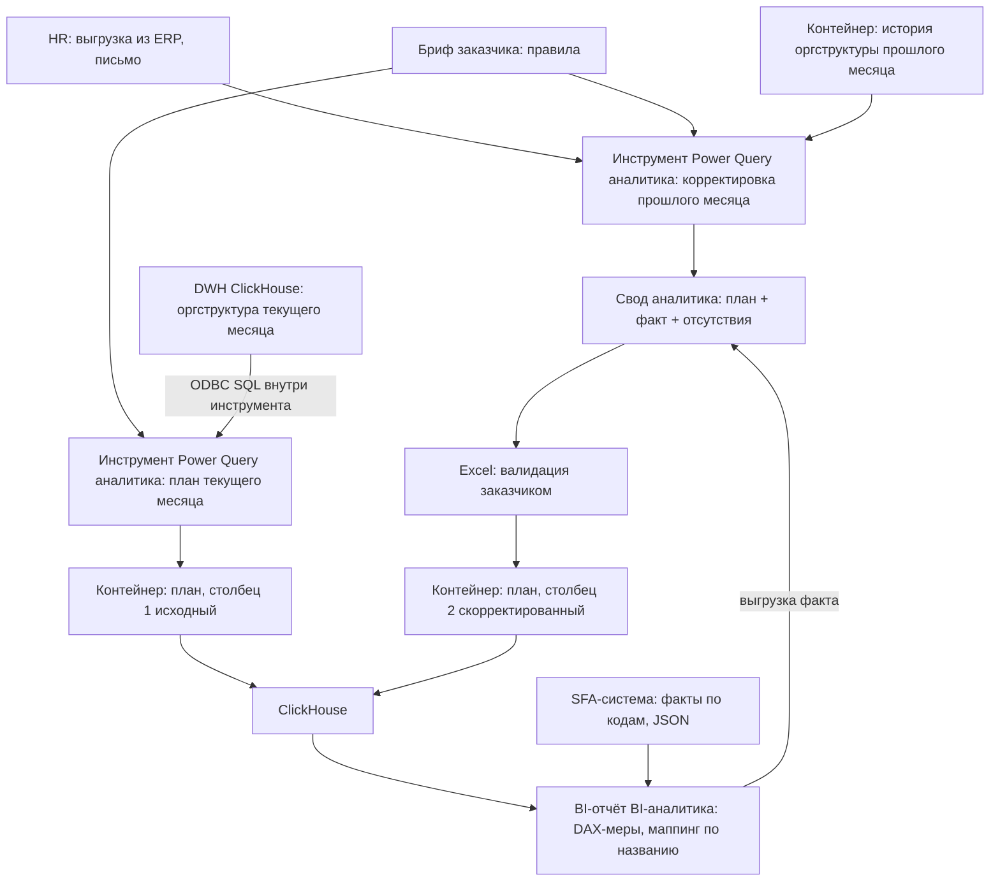

# Процесс: паспорт, владение, поток, правила, данные

## 1. Паспорт процесса

| Поле | Значение |
|---|---|
| Назначение | Ежемесячный расчёт плановых нормативов супервайзеров, корректировка плана прошлого месяца, подготовка данных для BI-отчёта выполнения |
| Триггер | Письмо HR с выгрузкой из ERP по отсутствиям супервайзеров за прошлый месяц, первые числа месяца |
| Вход | Бриф бизнес-заказчика с правилами; оргструктура из DWH; история оргструктуры из контейнера; факт из BI-отчёта; отсутствия из письма HR |
| Выход | Две версии плана в контейнере; данные для BI-отчёта |
| Периодичность | Ежемесячно |
| Трудоёмкость | Около 14 часов в месяц |
| Эффект | Цикл подготовки 3 дня → 4 часа |
| История | Миграция с 2024 года |
| Формальный владелец процесса | Не назначен |

Границы. В процессе: расчёт планов и корректировок, переработка данных, загрузка
и качество контейнеров, свод, отправка на валидацию, поддержка обновления
подключённой отчётности, инструкции. Вне процесса: сбор факта в SFA, разработка
DWH, создание BI-отчётов, расчёт вознаграждения.

Ограничение канала. Прямое подключение к ERP недоступно, проверено. Единственный
канал получения отсутствий — файл, который присылает сотрудник HR. Это
зафиксированное ограничение, не разрыв.

Два трека:

| Трек | Оргструктура | Валидация |
|---|---|---|
| План текущего месяца | текущая, из DWH | нет: грузится сразу по брифу |
| Корректировка прошлого месяца | прошлая, из истории контейнера | ручная валидация бизнес-заказчиком |

## 2. Граница владения

| Зона | Владелец | Состав |
|---|---|---|
| Инструмент расчёта | Аналитик, автор | Excel + Power Query: ODBC-подключения с SQL-запросами к DWH, дедупликация в SQL и M, расчёт плана с разбивкой по нормативам, DQ-фильтр привязок, CSV и загрузка в контейнер |
| Отчёт | BI-аналитик | Загрузка JSON SFA в отчёт, DAX-меры, маппинг факт → категории плана по названию, модель и связи отчёта |
| Хранилище | Команда DWH | ClickHouse, подхват контейнеров, реализация изменений схем по заявкам |
| Источник факта | Команда SFA | Каталог нормативов: коды и названия, переименования |
| Вход отсутствий | HR | Выгрузка из ERP, письмо |
| Правила и валидация | Бизнес-заказчик | Бриф, консолидация валидации включая BR |

Инструмент аналитика автоматический: выгрузка оргструктуры и покрытия выполняется
ODBC-запросами внутри Power Query, не отдельным ручным шагом. Ручные операции цикла:
приём письма HR, итоговая проверка результата исполнителем, валидация корректировки
заказчиком. Нормализация названий активностей в инструменте аналитика не выполняется;
сопоставление по названию реализовано только в DAX-мерах отчёта.

## 3. Поток данных

Контейнер — слой историчности. Хранит оргструктуру по месяцам и две версии плана.
DWH и BI-отчёт перезаписывают оргструктуру каждый месяц; историю держит только
контейнер. Столбец 1 — исходный план, столбец 2 — скорректированный; исходный
не затирается.

Замкнутый контур. План попадает в отчёт, меры отчёта сопоставляют факт SFA
с категориями плана, и этот факт выгружается обратно как вход для свода.
Факт для сверки — выход мер, а не сырые данные SFA по кодам. Независимая сверка
по кодам без прямого доступа к факту SFA невозможна.

Все вычисления — в Excel через Power Query.

## 4. Бизнес-правила

Правила задаёт бизнес-заказчик. Авторитетный источник — действующий бриф.
Расчёт реализует правила, не определяет их. Числовые параметры не публикуются.

| ID | Тип | Что определяет | Источник |
|---|---|---|---|
| R-01 | Базовый норматив | План по роли как функция размера команды и покрытия | Бриф |
| R-02 | Сезонность | Понижающий коэффициент для отдельных месяцев | Бриф |
| R-03 | Отсутствия | Корректировка на дни отпусков и больничных | Бриф + HR |
| R-04 | Первый месяц | Норматив не устанавливается | Бриф |
| R-05 | Приоритетная срезка | Снижение от наименее приоритетных активностей при превышении | Бриф + приоритеты |
| R-06 | Условия зачёта | Составные правила И/ИЛИ над кодами SFA; бинарная оценка | Бриф + DAX |
| R-07 | Лимиты | Потолки норматива для отдельных ролей | Бриф |

Правило R-06 существует только в тексте брифа и в DAX-мерах отчёта. Единого
справочника «категория плана → коды SFA + логика» нет. Знание маппинга — в головах
вовлечённых специалистов.

Категории плана составные: «норматив А или B», «F и V». Факты SFA атомарные:
A, B, E. Сопоставление составной категории и атомарных кодов выполняется
в мерах отчёта по названию.

## 5. Ключевые элементы данных

| Сущность | Класс | Ключ | Роль |
|---|---|---|---|
| Сотрудник / позиция | Master | код позиции | носитель норматива |
| Торговая точка | Master | код точки | покрытие |
| Вид активности SFA | Reference | код SFA | атомарный факт |
| Категория плана | Reference, составная | название категории | связь с фактом только по названию |
| Привязка точки к супервайзеру | Связь master | точка + позиция | критичный элемент |
| Оргструктура по месяцам | История | позиция × месяц | хранится в контейнере |
| План | Расчётные | сотрудник × месяц × категория, две версии | результат |
| Факт активности | Транзакционные | задача / визит | основание зачёта |

Критичные элементы данных: код позиции, код точки, привязка, категория плана,
период. Ошибка в любом меняет оценку выполнения конкретного человека.
