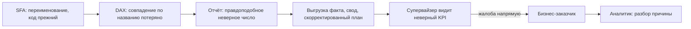

# Качество данных: контроли, разрывы, кейс

## Существующие контроли

| Контроль | Функция | Область DMBOK |
|---|---|---|
| Две версии плана, исходный сохранён | аудируемость корректировки | DQ 13, Modeling 5 |
| История оргструктуры в контейнере | воспроизводимость расчёта прошлого месяца | Architecture 4, Storage 6 |
| DQ-фильтр некорректных привязок точек | operational DQ покрытия | DQ 13 |
| Дедупликация в SQL-запросах ODBC-подключений инструмента и в Power Query | уникальность на двух слоях, оба внутри инструмента аналитика | DQ 13 |
| Расчёт плана с разбивкой по нормативам на M | автоматизация расчёта, устранение ошибок округления | DQ 13, Integration 8 |
| Ручная валидация корректировки заказчиком | human gate | Governance 3 |
| Итоговая проверка результата вручную и простыми формулами Excel | финальный sanity check исполнителя | DQ 13 |

Асимметрия бизнес-валидации. Корректировка прошлого месяца проходит ручную
валидацию заказчиком. План текущего месяца грузится сразу по брифу, без
бизнес-валидации; его контроли — автоматическая дедупликация (SQL, Power Query),
расчёт на M и итоговая ручная проверка исполнителя. Наблюдение о дизайне
контролей, не оценка людей.

## Разрывы

| Разрыв | Следствие | Область |
|---|---|---|
| Маппинг категория ↔ код только в брифе + DAX + головах | знание не передаваемо, bus factor | RDM 10, Metadata 12 |
| Переименование SFA без уведомления, join по названию | тихая ошибка, мониторинга нет | DQ 13, Governance 3, RDM 10 |
| Детектор — жалоба супервайзера | нет проактивного контроля | DQ 13 |
| Версии брифа не формализованы | нельзя восстановить правило расчёта месяца | Governance 3, Metadata 12 |

Версионирование значений плана есть — два столбца. Версионирования бизнес-правил
нет. Это разные уровни.

## Кейс: тихая ошибка маппинга

1. Команда SFA меняет название норматива, код не меняет.
2. DAX-меры связывают категорию плана и факт по названию. Переименованный факт
   перестаёт совпадать. Ошибки нет — факт тихо недоучитывается.
3. Отчёт показывает правдоподобное, но неверное выполнение.
4. Факт выгружается для свода; скорректированный план наследует ошибку.
5. Ручная валидация может не поймать: независимого факта по кодам для сверки нет.
6. План грузится, супервайзер видит неверный KPI.
7. Супервайзер жалуется напрямую заказчику, подтверждает реальный факт.
8. Заказчик приходит к аналитику; причина — переименование + join по названию
   + маппинг только в головах.

Задержка обнаружения — пока человек не заметит и не эскалирует. Системного
сигнала нет на всём пути. Корневая причина организационная: изменение справочника
не контролируется и не коммуницируется, ключ связи — нестабильное название.

Это отдельный механизм от фильтра привязок точек. Фильтр точек — существующий
операционный контроль покрытия. Тихий маппинг — разрыв reference data
и мониторинга. Два разных подраздела, не сливать.

Кейс показывает разницу между «система сломалась» и «система тихо врёт», и почему
human-gate без независимого источника факта не ловит такие ошибки. Это operational
DQ против strategic DQ: контроль на стороне расчёта против устранения корневой
причины на источнике.
